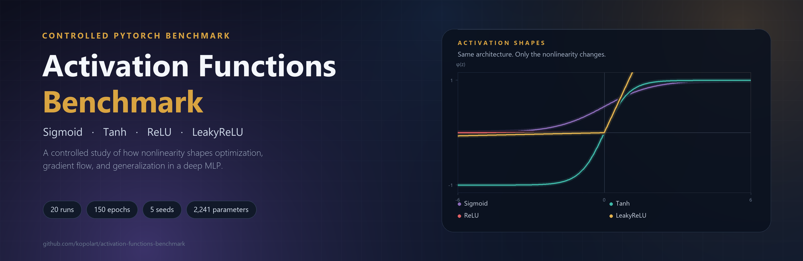
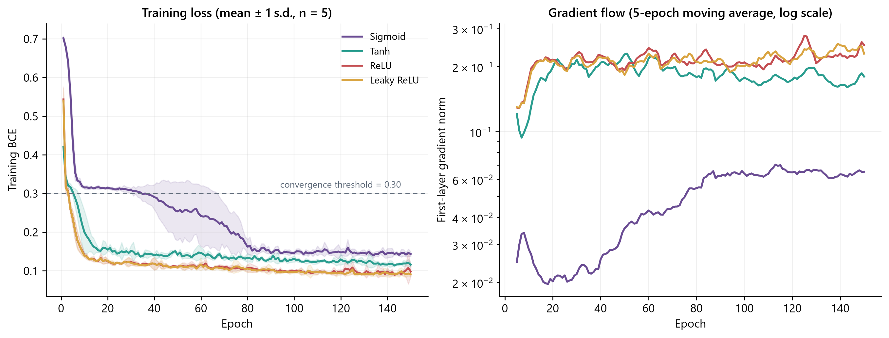
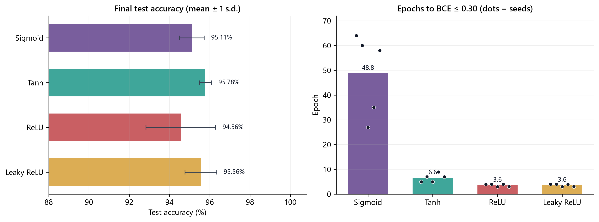
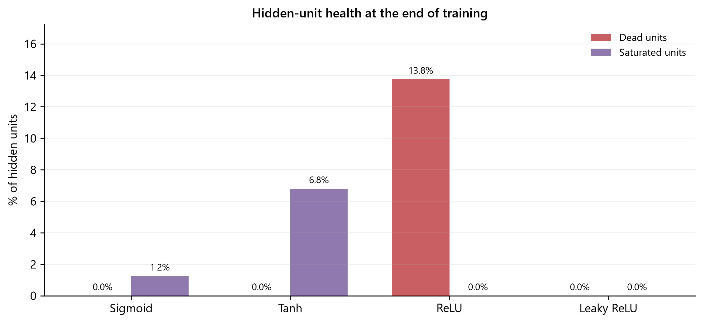
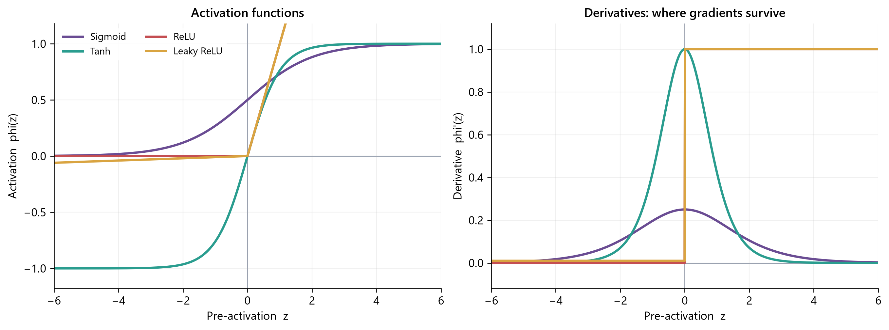

  

<h1 align="center">Activation Functions Benchmark</h1>

  <strong>How Sigmoid, Tanh, ReLU, and LeakyReLU shape optimization, gradient flow, and generalization in a deep MLP.</strong>

  
  
  
  
  
  

> **TL;DR** — On a fixed two-moons benchmark, ReLU-family activations crossed the 0.30 BCE threshold **13.6x faster** than Sigmoid (3.6 vs 48.8 epochs), yet **Tanh** delivered the best mean test accuracy (**95.78% ± 0.30%**). ReLU left **13.75%** of hidden units dead; LeakyReLU matched ReLU's speed with **0% dead units**. With five seeds, the accuracy gap was **not statistically significant** (one-way ANOVA, *p* = 0.27).

## Contents

- [Why this benchmark exists](#why-this-benchmark-exists)
- [Results at a glance](#results-at-a-glance)
- [The experiment](#the-experiment)
- [What the numbers say](#what-the-numbers-say)
- [Figures](#figures)
- [Quickstart](#quickstart)
- [Notebook](#notebook)
- [Project structure](#project-structure)
- [Reproducibility contract](#reproducibility-contract)
- [Documentation](#documentation)
- [Citation](#citation)
- [Contributing](#contributing)
- [License](#license)

---

## Why this benchmark exists

Activation functions are the only source of nonlinearity in a feed-forward network, yet they are frequently chosen by convention. This repository isolates their effect with a single controlled experiment: **same data, same architecture, same initialization, same optimizer, same schedule** — only the nonlinearity changes.

The result is a compact, reproducible reference for questions such as:

- Does the activation function change *accuracy*, or mostly *optimization speed*?
- Which nonlinearities suffer from vanishing gradients or saturation?
- How often do ReLU units die, and does LeakyReLU actually help?
- Are the observed differences large enough to matter beyond seed noise?

## Results at a glance

Mean ± sample standard deviation over five seeds. Bold marks the best value in each column. Dead units are hidden units that never activate. First-layer gradient norms and saturated-unit fractions are in the results guide.

| Activation | Test accuracy | Train BCE | Test BCE | Epochs to BCE ≤ 0.30 | Dead units |
|---|---:|---:|---:|---:|---:|
| Sigmoid | 95.11 ± 0.61% | 0.1434 | **0.1390** | 48.8 | 0.00% |
| Tanh | **95.78 ± 0.30%** | 0.1158 | 0.1430 | 6.6 | 0.00% |
| ReLU | 94.56 ± 1.73% | 0.0982 | 0.1751 | **3.6** | 13.75% |
| LeakyReLU (α = 0.01) | 95.56 ± 0.79% | **0.0909** | 0.1751 | **3.6** | 0.00% |

<em>Full per-seed numbers, confidence intervals, and statistical tests are in <a href="docs/RESULTS.md">docs/RESULTS.md</a>.</em>

## The experiment

| Control | Value |
|---|---|
| **Dataset** | Two moons: 600 samples, noise 0.22, stratified 70/30 split (420 train / 180 test) |
| **Preprocessing** | StandardScaler fitted on the training set only |
| **Model** | 2 → 32 → 32 → 32 → 1 MLP (2,241 trainable parameters) |
| **Initialization** | Xavier-uniform weights, zero biases; identical weights per seed across activations |
| **Optimizer** | Adam, learning rate 0.01, batch size 64, BCE-with-logits |
| **Budget** | 150 epochs, no early stopping, no learning-rate schedule, no dropout, no batch norm |
| **Replication** | 5 seeds × 4 activations = 20 complete training runs |
| **Primary metric** | Test accuracy; secondary: convergence epoch, gradient norm, dead/saturated units |

~~~mermaid
flowchart LR
    A["Input 2 features"] --> B["Linear 2→32 + activation"]
    B --> C["Linear 32→32 + activation"]
    C --> D["Linear 32→32 + activation"]
    D --> E["Linear 32→1 logit"]
~~~

The architecture is deliberately small enough to train in seconds, but deep enough (three hidden layers) for vanishing gradients and dead units to become visible.

## What the numbers say

### 1. Nonlinearity was not the accuracy bottleneck
All four activations finished above 94.5% test accuracy, and the best mean (Tanh, 95.78%) was only 1.22 percentage points above the worst (ReLU, 94.56%). A one-way ANOVA across the four groups returned **F = 1.43, p = 0.271**; Kruskal-Wallis gave **p = 0.249**. With five seeds, this benchmark does not support a claim that one activation is universally more accurate on this task.

### 2. ReLU-family wins the race, not the podium
ReLU and LeakyReLU reached the 0.30 training-loss threshold in **3.6 epochs on average**, versus 48.8 for Sigmoid and 6.6 for Tanh. But their final test BCE (0.175) was higher than Sigmoid's (0.139), and their mean test accuracy was not better. Faster optimization is not the same as better generalization.

### 3. Sigmoid is slow because gradients shrink
The mean first-layer gradient norm over the last ten epochs was **0.064** for Sigmoid versus **0.239** for ReLU — a factor of 3.7. Sigmoid's loss curve stays above the threshold for tens of epochs while the ReLU-family curves have already flattened. This is the classic vanishing-gradient signature, visible without any instrumentation beyond a gradient norm.

### 4. Tanh is the quiet overachiever
Tanh produced the highest mean accuracy and the smallest seed variance (± 0.30%), while converging roughly seven times faster than Sigmoid. It still saturates: **6.80%** of its hidden activations sit in the flat tail (|h| > 0.99), more than Sigmoid's 1.25%. Zero-mean outputs help optimization; they do not make saturation disappear.

### 5. Dead units are a ReLU tax
At the end of training, **13.75%** of ReLU hidden units were dead — non-positive for every training example — with substantial variation across seeds (8.33% to 17.71%). LeakyReLU, with a negative slope of only 0.01, kept **0%** dead units and matched ReLU's convergence speed. The fix is cheap; the failure mode is real.

<em>These are observations from one dataset, one architecture, and five seeds. They are hypotheses to test, not universal laws. See <a href="docs/METHODOLOGY.md#9-threats-to-validity">threats to validity</a>.</em>

## Figures

### Training dynamics

*Left: mean training BCE with ±1 s.d. bands. Right: mean first-layer gradient norm, shown as a 5-epoch moving average on a log scale. ReLU and LeakyReLU overlap almost exactly; Sigmoid climbs slowly out of a low-gradient regime.*

### Accuracy and convergence

*Left: final test accuracy (mean ± 1 s.d.). Right: first epoch at which training BCE ≤ 0.30; dots are individual seeds. The speed gap is large and consistent; the accuracy gap is small and noisy.*

### Hidden-unit health

*Dead units are ReLU outputs that never activate; saturated units are Sigmoid/Tanh outputs in the flat tail. ReLU trades dead units for speed; Tanh trades saturation for accuracy.*

### Activation shapes

*The four nonlinearities and their derivatives. The derivative panel explains the optimization behavior: Sigmoid's gradient never exceeds 0.25, Tanh's is bounded by 1.0 but decays in both tails, and ReLU's gradient is exactly 0 or 1.*

## Quickstart

~~~bash
git clone https://github.com/kopolart/activation-functions-benchmark.git
cd activation-functions-benchmark

python -m venv .venv
# Windows PowerShell
.venv\Scripts\Activate.ps1
# macOS / Linux
source .venv/bin/activate

python -m pip install -U pip
pip install -e ".[dev]"
~~~

Run the full benchmark (20 trainings, about 30–60 seconds on a modern CPU):

~~~bash
activation-benchmark run --epochs 150 --seeds 5 --output-dir results
~~~

The same entry point works as a module:

~~~bash
python -m activation_benchmark run --epochs 150 --seeds 5 --output-dir results
~~~

Rebuild figures from the canonical results without retraining:

~~~bash
activation-benchmark figures --results results/results.json --output-dir results/figures
~~~

Run a quick smoke test:

~~~bash
activation-benchmark run --epochs 2 --seeds 1 --output-dir /tmp/activation-smoke
~~~

### Outputs

~~~text
results/
├── results.json                 # 20 runs, full per-epoch histories
├── activation_summary.csv       # aggregate table
└── figures/
    ├── activation_shapes.png
    ├── loss_and_gradient.png
    ├── accuracy_and_convergence.png
    └── health_profile.png
~~~

## Notebook

The executed notebook walks through the experiment from data construction to the final comparison, with the same code paths as the CLI:

**[notebooks/activation_functions_benchmark.ipynb](notebooks/activation_functions_benchmark.ipynb)**

It is committed with outputs, so the figures and tables are visible on GitHub without running anything. To reproduce it locally:

~~~bash
jupyter nbconvert --to notebook --execute notebooks/activation_functions_benchmark.ipynb --inplace
~~~

## Project structure

~~~text
.
├── src/activation_benchmark/
│   ├── analysis.py          # aggregation, ANOVA, Kruskal-Wallis, JSON/CSV I/O
│   ├── cli.py               # activation-benchmark run | figures
│   ├── config.py            # the single ExperimentConfig
│   ├── data.py              # two-moons split with leakage-free scaling
│   ├── metrics.py           # accuracy and activation-health diagnostics
│   ├── models.py            # activation factory and MLP builder
│   ├── plotting.py          # publication-quality figures
│   └── training.py          # training loop and experiment runner
├── notebooks/               # executed end-to-end walkthrough
├── tests/                   # fast invariants and a two-epoch smoke test
├── docs/                    # methodology, results, reproducibility
├── results/                 # canonical JSON, CSV, and figures
├── assets/                  # repository banner
└── .github/workflows/ci.yml # lint + tests on Python 3.11 and 3.12
~~~

## Reproducibility contract

- **Data seed 42** fixes the split and the scaler.
- **Model seeds 0–4** fix initialization. Weights are identical across activations for each seed; the activation module consumes no random numbers.
- **Batch generator seed** is seed + 1000, so each run sees the same minibatch order as its counterparts.
- **One CPU thread** (torch.set_num_threads(1)) keeps timings comparable. Accuracy is deterministic for this stack on CPU; wall-clock times are hardware-dependent.
- **No hidden tuning.** The reported runs use the defaults in ExperimentConfig; there is no early stopping or checkpoint selection.

The canonical artifact is [results/results.json](results/results.json). Its SHA-256 is recorded in [docs/REPRODUCIBILITY.md](docs/REPRODUCIBILITY.md).

## Documentation

| Guide | What it covers |
|---|---|
| [Methodology](docs/METHODOLOGY.md) | Design, equations, metrics, controls, threats to validity |
| [Results](docs/RESULTS.md) | Full tables, per-seed numbers, statistical tests, interpretation |
| [Reproducibility](docs/REPRODUCIBILITY.md) | Environment, commands, checksums, determinism notes |
| [Contributing](CONTRIBUTING.md) | Setup, style, tests, and how to add an activation |
| [Code of Conduct](CODE_OF_CONDUCT.md) | Community expectations and enforcement |
| [Security](SECURITY.md) | Supported versions and private vulnerability reporting |
| [Changelog](CHANGELOG.md) | Release history |

## Citation

If this benchmark is useful in your work, please cite it as:

~~~bibtex
@software{yousefi2026activation,
  author  = {Yousefi, Ali},
  title   = {Activation Functions Benchmark: A Controlled PyTorch Study of Nonlinearity in Deep MLPs},
  year    = {2026},
  version = {1.0.0},
  url     = {https://github.com/kopolart/activation-functions-benchmark}
}
~~~

A machine-readable record is available in [CITATION.cff](CITATION.cff).

## Contributing

Issues and pull requests are welcome. Good first contributions include additional activation functions, alternative datasets, and extra seeds. Please read [CONTRIBUTING.md](CONTRIBUTING.md) before opening a PR, and run:

~~~bash
ruff check src tests
pytest -q
~~~

## License

Released under the [MIT License](LICENSE). Copyright © 2026 Ali Yousefi.

---

  Built with PyTorch, scikit-learn, and a preference for controlled experiments over folklore.

